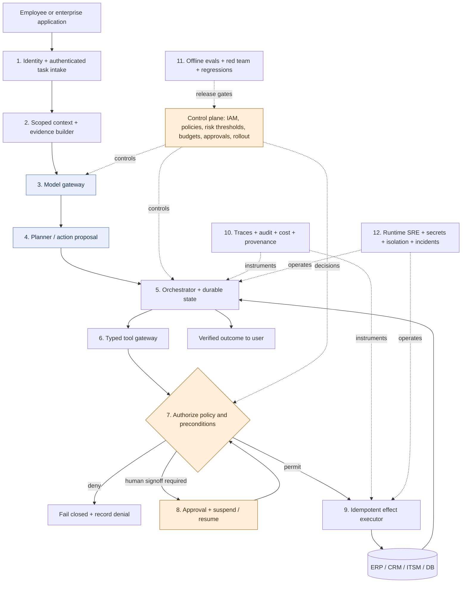
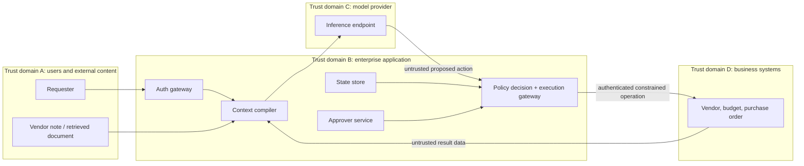
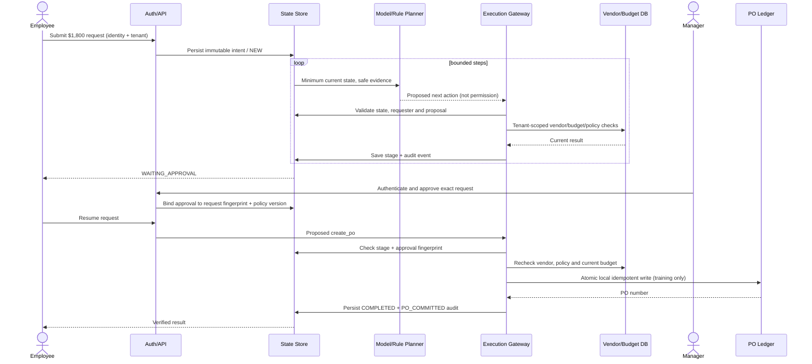
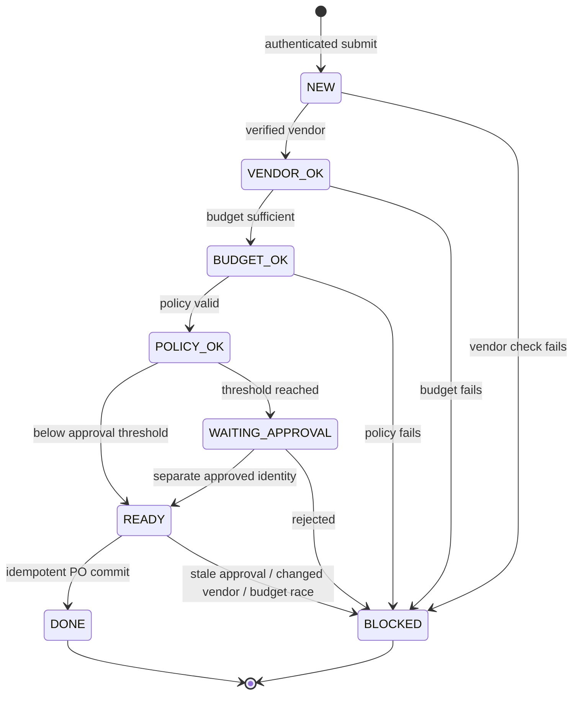

# Enterprise Harness Reference Architecture

## Architecture view: data plane and control plane



The numbered boxes map to `04_...md` and `05_...md`. Logging, evaluation and platform controls are cross-cutting, not literally downstream of all other components. The diagram is a **logical architecture**, not a prescription for microservices.

## Boundary view: distinguish trust from data flow



### Boundaries with real attack implications

| Boundary | What crosses | Risk | Enforcement |
|---|---|---|---|
| User → intake | Authenticated principal + validated request | Spoofed user / tenant | SSO/OIDC, ABAC, request schema, quotas |
| Source → context | Retrieval results / vendor note | Prompt injection, incorrect provenance, cross-tenant bleed | ACL-filter before retrieval, source IDs, trust labels, untrusted segmentation |
| App → model | Compiled task context | Sensitive-data export, token spend, retention | Data minimization, provider approval, region and no-store policy where applicable |
| Model → gateway | Structured action proposal | Out-of-order tool calls, invented approval | Allowlist, state check, tool schema, hard authorization |
| Gateway → ERP | Specific action + server-side parameters | Duplicate order / TOCTOU / wrong tenant | Service identity, narrow API scope, precommit checks, idempotency |
| Human → approval store | Decision about immutable request | Self-approval, spoofed approval, stale approval | Independent identity, MFA where required, SoD, fingerprint and expiration |
| Agent → operations | Spans, events, metrics | PII leakage and missing evidence | Structured redacted telemetry, RBAC, retention and audit export |

## Control-plane design

The control plane is responsible for **normative authority**: which action is allowed, by whom, against which entity and under which policy version. Store versioned policies, scope definitions, thresholds and approval states independently of the model session. An exception should be an explicit authorized business event, not a line of instruction generated by an agent.

Minimum policy-decision input:

```json
{
  "principal": {"subject": "alice", "tenant": "acme", "role": "requester"},
  "action": "create_po",
  "resource": {"request_id": "REQ-1800", "tenant": "acme"},
  "evidence": {"vendor_verified": true, "budget_cents": 300000},
  "approval": {"required": true, "policy_version": "procurement-v1"},
  "environment": {"mode": "training", "simulation": true}
}
```

A real policy engine should return **permit/deny/needs-approval** with a policy version, obligations, reason code and audit reference. A model instruction such as “do not make unapproved purchases” is defense in depth, **not** authorization.

## End-to-end sequence (high-value request)



## Six failure traces and their containment

1. **Injected vendor instruction:** planner proposes `create_po` while stage `NEW` → execution gateway emits `DENIED_ACTION` → no PO.
2. **Unverified vendor:** vendor lookup returns inactive/unverified → state `BLOCKED` → nothing further executes.
3. **Insufficient budget:** check or precommit compare-and-decrement fails → state `BLOCKED` → no negative budget.
4. **Missing human approval:** request pauses at `WAITING_APPROVAL`; no path from that stage to commit without manager decision.
5. **Stale approval:** amount/purpose/version differs from fingerprint → precommit fails closed.
6. **Repeated execution:** already completed requests execute zero further actions; PO ledger has unique request and idempotency keys.

## State machine contract



Every `create_po` request is checked for `stage == READY`, not merely for a convincing textual statement. The request's status transitions are persisted in SQLite for local recovery. At an ERP boundary, replace the single-DB assumption with an external idempotency contract plus reconciliation/outbox.

## Architecture decisions

- **One agent, fixed-state controller:** easier to reason about failure and control boundaries. Add specialized subagents only if independent evals show improved throughput or quality.
- **Model returns proposals, not authoritative business decisions:** permits model replacement without redesigning financial controls.
- **Persist after every sanctioned step:** bounded replay surface and straightforward human approval resume.
- **Strict separation of trusted identity and model-visible text:** role claims come from an enterprise identity plane, never from a prompt.
- **Policy enforced twice:** initial checks inform the plan; precommit checks prevent TOCTOU.
- **Local atomic effect for teaching:** do not infer distributed exactly-once guarantees.

For upstream architecture examples see [OpenAI's hosted Agents API architecture](https://developers.openai.com/api/docs/guides/agents-api/architecture), [LangGraph design](https://github.com/langchain-ai/langgraph), and [Temporal Python SDK](https://github.com/temporalio/sdk-python).
