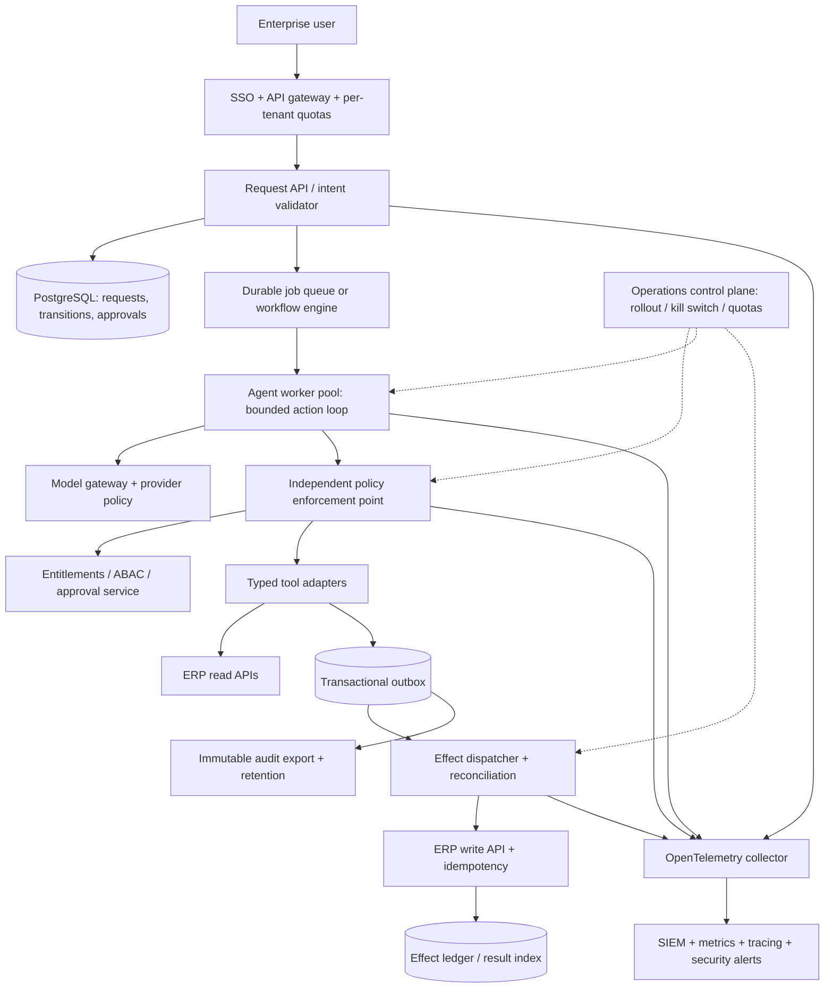
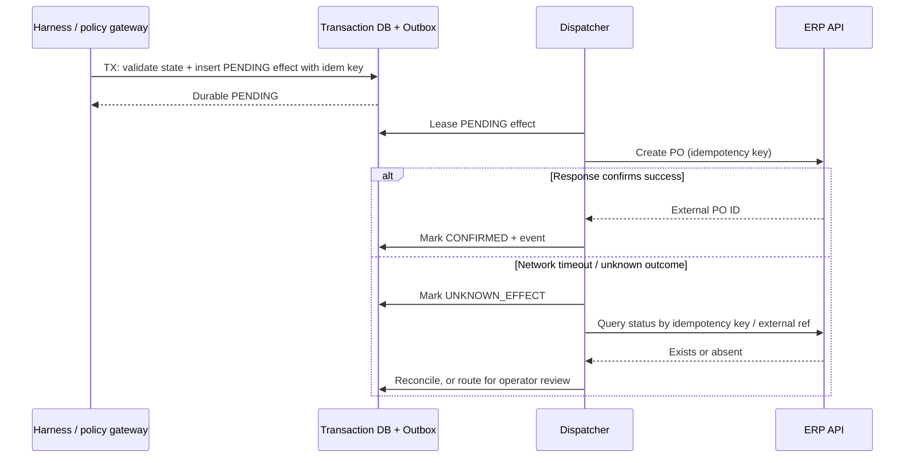

# Productionization Blueprint, Reliability Model, Deployment Gates and ADRs

The reference implementation is a **tested training artifact**, not a deployable enterprise procurement service. This document names its gaps and supplies a concrete replacement design. In a regulated environment, the harness must undergo a normal architecture review, security assessment, API certification, resilience testing and change-control process.

## Reference deployment topology

A deployment is not automatically “production-ready” because it uses Kubernetes, Temporal, LangGraph, MCP or a managed agent platform. **Failure recovery and authorization semantics must be established at each boundary.**

## Gap-to-engineering-work mapping

| Lab design | Production gap | Required engineering work | Acceptance evidence |
|---|---|---|---|
| CLI-provided `Actor` role | Identity can be impersonated | Enterprise IdP/OIDC; verify issuer/audience/expiry/signature; entitlement lookups; delegated actor evidence | Negative role/tenant tests + IAM audit |
| Single SQLite file | Poor multi-replica operations | PostgreSQL/managed DB; schema migration; row-level security; backups, HA, locks | Failover and concurrent request test |
| Synthetic vendor and budget | No real ERP truth | Versioned read-only ERP adapters, scoped service identities, staleness SLA | Contract tests against ERP sandbox |
| Local PO write | Unknown remote write outcome | Transactional outbox + ERP idempotency key + reconciliation | Crash-after-remote-commit chaos drill |
| Local SHA-256 audit chain | Privileged writer can rewrite chain | Immutable SIEM/WORM export, signatures, retention and chain custody | Audit completeness and tamper exercise |
| Role flag for approver | No real human assurance | SSO, MFA for relevant spend, SoD rules, approval expiry, revocation and escalation | Approval policy negative matrix |
| In-process step loop | No worker fleet or queue | Durable orchestrator, backpressure, job lease, DLQ, retries and compensation | Worker termination + redelivery exercise |
| Model sees purpose/vendor note | Provider and data-handling risk | Classification, masking, residency, consent/contracts, retention and DLP | Data-flow approval; leakage red team |
| Rule-based policy constants | Policy change governance | Versioned policy bundles, review, effective dates, decision logs | Policy regression and rollback test |
| Limited telemetry | No production SRE visibility | OTel + metrics; redaction and RBAC; per-tenant dashboards | SLO instrumented pilot |
| One-shot 15-test suite | Missing model/real connector coverage | Golden evals, attack suites, load, chaos, security pen test, staging | Signed release gate report |
| No tool-level kill switch | Can't stop compromised write surface centrally | Gateway deny-all-privileged-actions flag; drain/hold outbox | Emergency drill |
| Hardcoded global request PK | Potential cross-tenant ID collision | Composite `(tenant_id, request_id)` uniqueness and tenant-aware references | Multitenancy collision test |
| No encrypted data fields | Sensitive data at rest | Encryption and data classification; TTL/retention; deletion workflow | Privacy review and penetration test |

## Durable effect model for a real ERP

Use an **outbox** (or equivalent durable workflow command ledger) and an ERP idempotency key. Do not assume a remote system participates in the application's SQL transaction.

**Avoid claiming exactly once** over an API that does not support duplicate-safe operations. If the ERP has neither idempotency nor query-by-external-reference, create a controlled manual-reconciliation process for uncertain outcomes. Use expiring leases, dead-letter handling and per-effect tracing. Reconcile authorization/policy revocation before dispatch as required by business rules.

## Recommended runtime boundaries

**API tier:** validates authenticated intent; writes immutable request snapshots; refuses requests without an entitlement. API tier should not call the LLM to decide the user's role or spend cap.

**Worker tier:** bounded max steps/time/cost; fetches authoritative state; asks a planner for a typed action; calls the policy gateway; saves checkpoints. Tool adapters have distinct service identities and secrets.

**Model tier:** provider gateway with allowlisted models, data minimization, version pinning, timeout/usage budgets, rate limiting, regional controls and fallback policy. Refusals and malformed outputs cause safe non-execution.

**Policy tier:** independently governed PEP/PDP; explicit version; allow/deny/require approval; obligations; audit. High-risk actions and network egress can be disabled independently of workers.

**Effects tier:** durable side-effect ledger; idempotency, reconciliation, retry classification and operator quarantine of uncertain outcomes.

**Observability tier:** correlation ID connects request, model, planner, approval, tool action, outcome and incident. Sensitive payload capture is opt-in under an approved data-retention policy, not the default.

## Threat model: assets, attacker surfaces and controls

| Asset | Plausible attacker surface | Defensive design |
|---|---|---|
| Purchase authority | Prompt-injected supplier note; compromised model | Action-stage gateway + policy + approval |
| Supplier/budget data | Cross-tenant prompt/retrieval or overbroad tool | Tenant scope, RBAC/ABAC, data minimization |
| External ERP | Replay, partial commit, malicious generic tool | Narrow adapter, outbox, idempotency, no arbitrary shell/SQL |
| Human sign-off | Claimed approval in message; forged identity | Authenticated separate approval, request hash, expiry |
| Audit evidence | Missing events or DB manipulation | Structured audit export to immutable storage |
| Secrets | Tool output, prompt inclusion, verbose traces | Secret manager, scope, short-lived credentials, redaction |
| Model budget | Recursive loops, huge retrieved context | Step cap, token estimate/cost budgets, per-tenant quota |
| Reliability | Model/ERP outage, worker crash, race | Circuit breaker, checkpoint, queue, effect reconciliation |

## Example operating runbooks

### Runbook: disable privileged effects

**Trigger:** unauthorized-action signal, unusual PO spike, policy service health failure, suspected prompt-injection exfiltration. **Response:** set a centrally enforced gateway deny flag for `irreversible_write`; stop outbox dispatch for affected tenants; preserve all in-flight state and correlation IDs; allow approved read-only diagnostics. **Recovery:** assess committed effects, reconcile ERP records, obtain security/business release approval, restore through gradual canary.

### Runbook: unknown remote effect

**Trigger:** ERP API times out after receiving a create request. **Response:** mark effect `UNKNOWN_EFFECT`; do **not** blindly retry with a new idempotency key; query by original key/external reference; obtain authoritative effect result; only then close or redrive; audit every determination.

### Runbook: bad model/prompt rollout

**Trigger:** elevated denied proposals, task failures or cost/task after a model/prompt version change. **Response:** pin to previous validated version; route in-flight tasks through existing invariant-safe gateway; compare golden trajectories by version; require pre-specified release gates before restoring traffic.

## Architecture Decision Records

### ADR-001 — Model is a proposer, gateway is the enforcer

**Decision:** model output cannot directly call privileged business adapters. **Why:** lower-trust prompts and uncertain outputs cannot determine authority. **Trade-off:** reduced autonomous flexibility and some added latency. **Test:** out-of-order `create_po` denied.

### ADR-002 — Start with one agent and a deterministic skeleton

**Decision:** a bounded single agent controls next-action proposals within a fixed state machine. **Why:** simple reasoning and audit; multiagent delegation is not valuable until measured. **Revisit:** when specialist tasks and parallel branches yield verified speed/quality improvements without added unacceptable risk.

### ADR-003 — Approval is a separate immutable authorization event

**Decision:** a manager action binds to request fingerprint and policy version, not to chat text. **Why:** ensure separation of duties and prevent stale approval reuse. **Trade-off:** approval service complexity and workflow pause time.

### ADR-004 — Use local atomic semantics only in the lab

**Decision:** SQLite PO ledger and budget update share one transaction for training. **Production decision:** durable outbox and ERP idempotency/reconciliation. **Why:** cannot guarantee distributed exactly-once with an ordinary HTTP write.

### ADR-005 — Keep audit separate from diagnostic traces

**Decision:** structured redacted spans for operations; signed/immutable business audit export for evidence. **Why:** traces may be sampled or have shorter retention; financial audit has different integrity and retention obligations.

### ADR-006 — Release gates evaluate forbidden *effects*, not only textual outputs

**Decision:** any unauthorized side effect blocks a release, even if task-level answer quality looks strong. **Why:** fluent responses can obscure incorrect state changes.

## 30/60/90-day engineering rollout (illustrative)

**Days 0–30:** business policy owner and system owner named; risk classification; typed resource contracts; approval specification; threat model; prototype deterministic gateway; baseline unit tests and red-team set.

**Days 31–60:** enterprise identity integration; isolated ERP sandbox; durable orchestrator; outbox and idempotency; OTel/SIEM pipeline; policy versioning; chaos tests; model gateway data controls; baseline cost metrics.

**Days 61–90:** historical shadow evaluation; risk-limited canary; synthetic replay and race tests; incident drill; sign-off on SLOs and audit evidence; expand only categories with measured operational quality and no critical authorization violations.

This is a planning sequence, **not a duration or delivery commitment**; complexity varies by enterprise ERP, IAM, data classification and compliance scope.

## Production sign-off checklist

- [ ] Business owner signed allowed actions, financial limits and exception workflows.
- [ ] Identity team proved issuer/audience, role, tenant, SoD and approval revocation checks.
- [ ] Security reviewed tool scopes, prompt injection, egress, sandboxing, secrets and DLP.
- [ ] Privacy/legal reviewed data flow, retention, provider contractual terms and residency.
- [ ] ERP owner verified idempotency, timeout/reconciliation and downstream concurrency behavior.
- [ ] SRE verified disaster recovery, error budgets, dashboards, incident stop and rollback.
- [ ] QA supplied golden trajectory evals, red-team reports, replay/chaos tests and coverage evidence.
- [ ] Audit owner verified effect-to-approval chain with protected retention and retrieval.
- [ ] Finance/product measured time saved, human handling, actual model/tool cost and rework.
- [ ] Deployment controls support canary/rollback by model, prompt, policy and adapter version.
